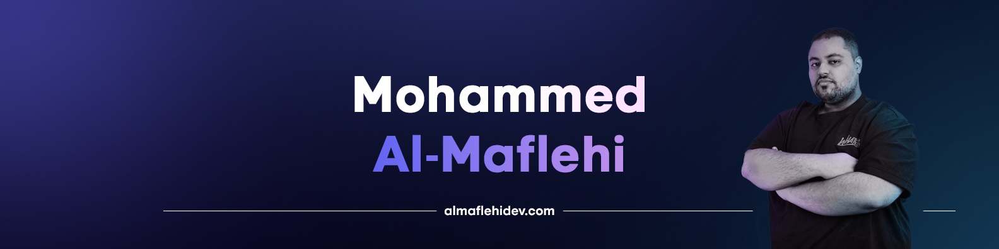
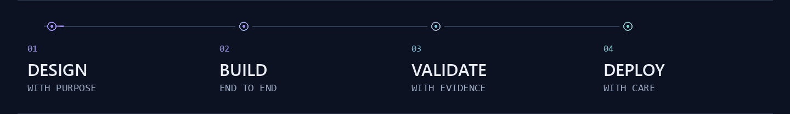
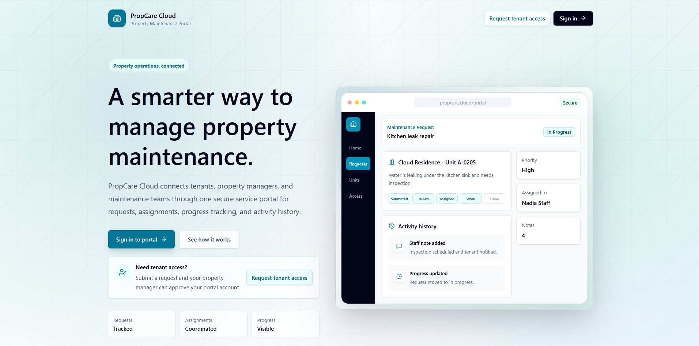
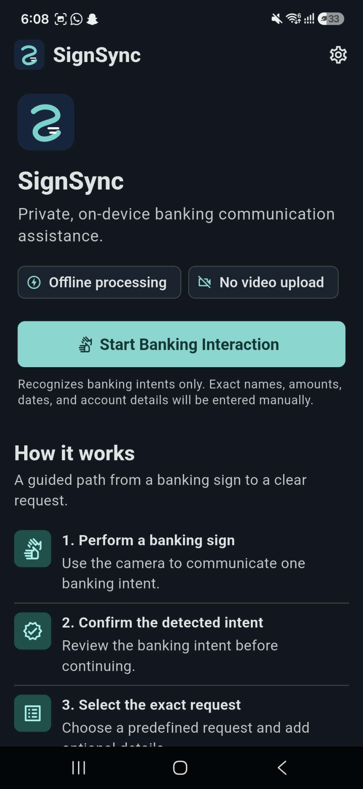
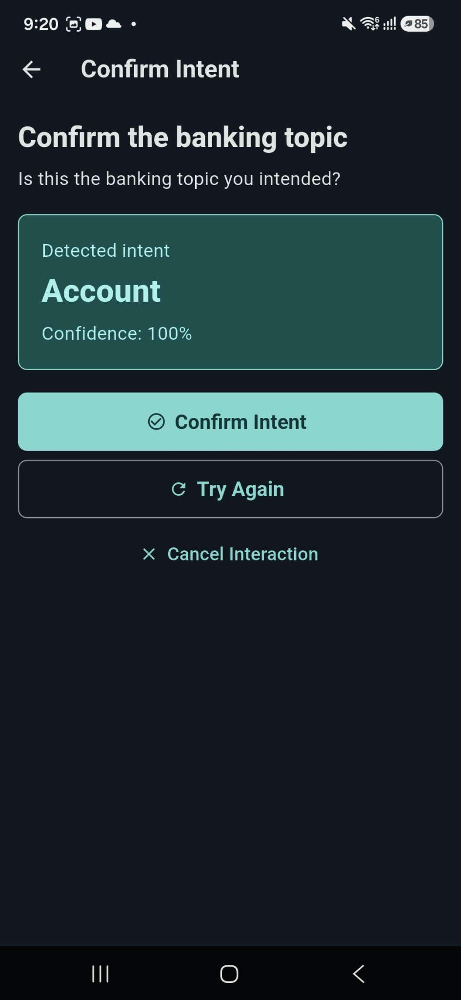
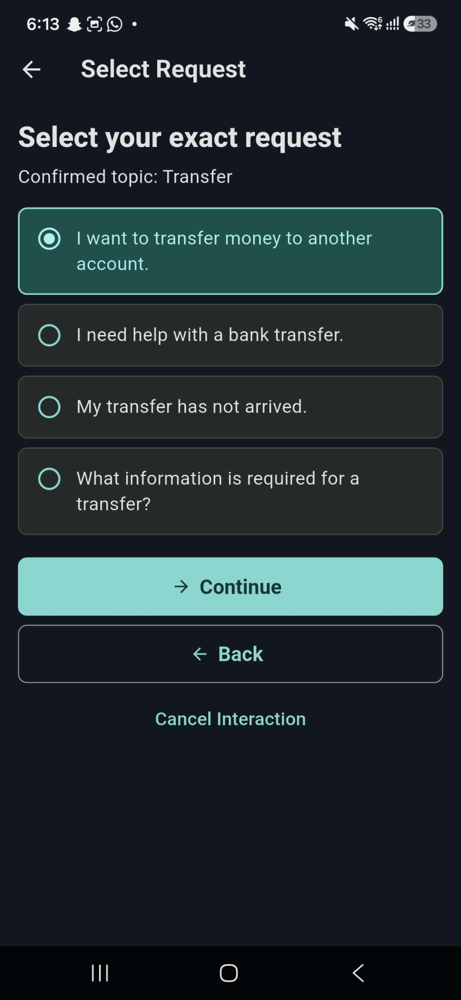

  

### Software Engineer · Cloud Systems · Applied AI

**From thoughtful interfaces to deployed systems. From camera frames to on-device intelligence.**

<a href="https://www.almaflehidev.com/"><strong>Portfolio</strong></a> &nbsp; / &nbsp; <a href="https://www.linkedin.com/in/mohammed-al-maflehi-926a28330/"><strong>LinkedIn</strong></a> &nbsp; / &nbsp; <a href="mailto:almaflehi0@gmail.com"><strong>Email</strong></a> &nbsp; / &nbsp; <a href="#selected-work"><strong>Projects</strong></a>

<picture>
  <source media="(max-width: 600px) and (prefers-reduced-motion: reduce)" srcset="assets/engineering-flow-mobile.png" />
  <source media="(max-width: 600px)" srcset="assets/engineering-flow-mobile.gif" />
  <source media="(prefers-reduced-motion: reduce)" srcset="assets/engineering-flow.png" />
  
</picture>

## A Little About Me

I'm **Mohammed Abdulsalam Almaflehi**, a Software Engineering graduate from **Asia Pacific University of Technology & Innovation**, based in Malaysia. I build full-stack applications, AWS-backed systems, and privacy-preserving mobile AI experiences.

I care about the work behind the interface: clear architecture, access boundaries, dependable data flows, reproducible evaluation, and tests that support the claims. My projects cover the full path from a user need to a working, documented system.

**Open to software engineering, full-stack, cloud, and applied AI opportunities.**

## Selected Work

### 01 / PropCare Cloud

**Full-stack product engineering meets event-driven AWS infrastructure.**

A multi-role property maintenance platform connecting owners, managers, tenants, and maintenance teams, from tenant registration and approval to work orders, private attachments, and notifications.

- **End-to-end implementation:** React and TypeScript frontend, ASP.NET Core APIs, Entity Framework Core, and PostgreSQL.
- **Access and privacy:** JWT authentication, backend-enforced RBAC, tenant-data isolation, and authorised, short-lived S3 attachment URLs.
- **Cloud architecture:** S3 frontend, Elastic Beanstalk backend, RDS database, API Gateway and Lambda, SNS/SQS messaging, CloudWatch, and X-Ray.
- **Engineering evidence:** **127 passing backend xUnit tests** recorded in the repository's validation results.

Academic team assignment. I was the sole developer responsible for the frontend, backend, database, AWS integration, deployment tooling, and testing.

**[Explore the repository](https://github.com/ALMAFLEHI/PropCareCloud)** &nbsp; · &nbsp; **[Architecture](https://github.com/ALMAFLEHI/PropCareCloud#cloud-architecture)** &nbsp; · &nbsp; **[Validation evidence](https://github.com/ALMAFLEHI/PropCareCloud#verified-engineering-results)**

---

### 02 / SignSync

**On-device intelligence. Human confirmation. Privacy by design.**

  
  &nbsp;
  
  &nbsp;
  

My Final Year Project: an Android application that recognises **40 isolated ASL banking intents** and turns a confirmed intent into a clear, banker-readable service request.

- **Mobile + native pipeline:** Flutter and Dart, Kotlin and CameraX, MediaPipe hand landmarks, and a TensorFlow Lite classifier.
- **Local by design:** Camera frames and model inference stay on the phone. Confidence-based retry and customer confirmation keep the user in control.
- **Measured performance:** **95.50% held-out accuracy** and **95.42% macro F1** on 200 test samples.
- **Validation record:** **108 Flutter tests** and **92 Python tests passed** in release validation.

**[Explore the repository](https://github.com/ALMAFLEHI/SignSync)** &nbsp; · &nbsp; **[Architecture](https://github.com/ALMAFLEHI/SignSync#system-architecture)** &nbsp; · &nbsp; **[Evaluation](https://github.com/ALMAFLEHI/SignSync#evaluation)**

Research scope: isolated banking intents, one primary participant, and one phone capture environment. Not continuous ASL translation, a production banking system, or a claim of broad real-world recognition accuracy.

## Tools I Use to Build

| Area | Technologies and practical experience |
| :--- | :--- |
| **Languages** | TypeScript, JavaScript, C#, Python, Java, Dart, Kotlin, SQL |
| **Web & backend** | React, HTML, CSS, Tailwind CSS, ASP.NET Core, Entity Framework Core, REST APIs, Jakarta Servlets / JSP |
| **Mobile & applied AI** | Flutter, Android CameraX, TensorFlow / TensorFlow Lite, MediaPipe, model evaluation, on-device inference |
| **Cloud & data** | AWS S3, Elastic Beanstalk, RDS, API Gateway, Lambda, SNS, SQS, CloudWatch, X-Ray; PostgreSQL, MySQL |
| **Quality & delivery** | xUnit, Flutter tests, Python tests, Postman, functional / regression testing, UAT, Git, GitHub, Agile / Jira |

## Beyond the Flagships

**[Course Recovery System](https://github.com/ALMAFLEHI/CourseRecoverySystem)** · Java / Jakarta EE / MySQL 
Academic eligibility, recovery planning, progress tracking, reporting, and audit workflows.

**[FoodSwift](https://github.com/ALMAFLEHI/FoodSwift)** · Flutter / Dart / Firebase 
Campus canteen ordering with student, staff, and admin workflows.

**[Developer Portfolio](https://www.almaflehidev.com/)** · Web / UI / Personal brand 
A closer look at my background, projects, and engineering journey.

## Experience & Foundations

**Product Development & Testing Intern · LeProfile Digital Services** 
July - November 2025 · Selangor, Malaysia

Functional, regression, exploratory, and integration testing; REST API validation with Postman; reproducible defect reports; usability and compatibility checks; and release-readiness / UAT support.

**BSc (Hons) Software Engineering · Asia Pacific University** 
2023 - 2026 · Kuala Lumpur, Malaysia

Additional training in **Google Agile Project Management**, **Meta Version Control**, and **Agile with Atlassian Jira**. Arabic native speaker; professional English proficiency.

---

### Let's Build Something Worth Using

Practical products. Clear architecture. Honest evidence.

**[Visit My Portfolio](https://www.almaflehidev.com/)** &nbsp; · &nbsp; **[Connect on LinkedIn](https://www.linkedin.com/in/mohammed-al-maflehi-926a28330/)** &nbsp; · &nbsp; **[Get in Touch](mailto:almaflehi0@gmail.com)**

Project metrics above are documented validation snapshots, not live counters. Screenshots show the actual applications; project repositories contain the detailed scope, evidence, and limitations.

